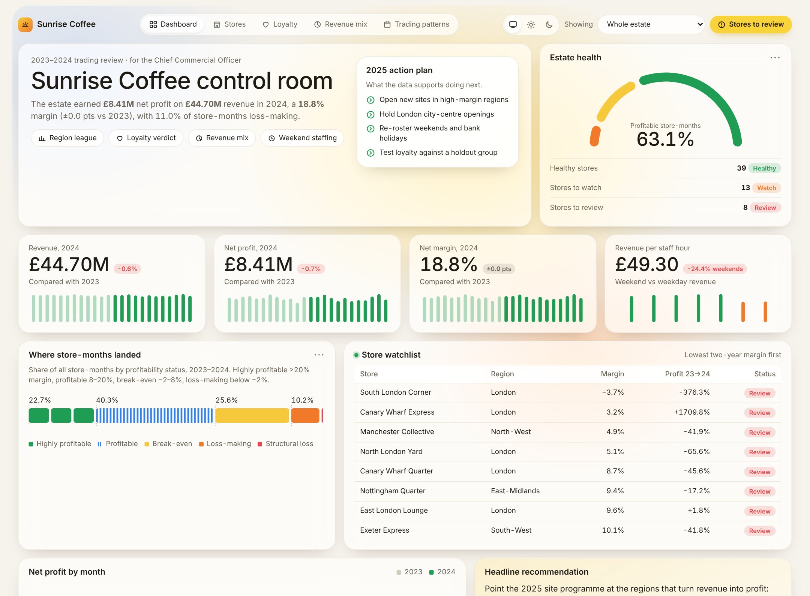

# Sunrise Coffee Control Room

An interactive performance review of **Sunrise Coffee Chain**, a 60-store UK coffee estate, covering 2023–2024 trading. Built for the **DataDNA Dataset Challenge (October 2026)**.

The brief: act as a senior commercial analyst reporting to the Chief Commercial Officer, and answer four questions ahead of the 2025 expansion plan:

1. Which store formats and regions actually drive profit?
2. Does the loyalty programme generate a return?
3. How is the revenue mix (espresso, filter, food, retail beans) shifting?
4. How do weekly, holiday and seasonal patterns affect trading?

**Live dashboard:** `[https://bayugo.github.io/sunrise-coffee-dashboard/](https://bayugo.github.io/sunrise-coffee-dashboard/)



---

## Key findings

| # | Finding | Evidence |
|---|---------|----------|
| 1 | **London is the drag on the estate.** | 8.5% net margin vs 18.8% estate-wide; 25.6% of London store-months are loss-making; London profit fell 25.5% in 2024. The weakest stores are mostly London city-centre sites. |
| 2 | **Labour, not rent, decides margin.** | Staffing cost as % of revenue correlates **−0.83** with store margin. Rent barely relates to revenue (r = 0.14): high-rent store-months earn 10.6% margin vs 21.6% in the low band, on near-identical revenue. |
| 3 | **Loyalty members don't spend more per visit.** | £7.05 per transaction for members vs £7.08 for non-members. Member revenue share tracks adoption almost 1:1 (r = 1.00). Redemptions cost 5.8% of member spend, so the scheme only pays back if it drives at least 5.8% *extra* spend. |
| 4 | **The revenue mix is standing still.** | Espresso ~46%, food ~26% (down 0.3 pts), filter ~19%, retail beans ~9%. Filter coffee has the highest catalogue margin (88.3%) but only 19.3% of revenue. |
| 5 | **The week matters more than the season.** | Weekend revenue is 24.4% below weekdays on the same staff hours, so revenue per staff hour drops from £53.10 to £39.90. Bank holidays trade 34.4% below a standard day. Monthly profit is flat, and no seasonal peak repeats across both years. |

### Recommendation to the CCO

- **Expansion:** prioritise the regions that convert revenue into profit, namely Northern Ireland (28.4% margin), West Midlands (24.5%) and Wales (22.8%). Hold London city-centre openings until the flagged stores recover.
- **Cost base:** re-roster weekends and bank holidays to demand. Use staffing cost as a share of revenue as the gating KPI for new sites.
- **Loyalty:** keep investment flat in 2025 and run a holdout test. Expand only if members show at least 5.8% incremental spend.

---

## Dashboard features

- **Five tabs:** Dashboard overview, Stores & regions, Loyalty, Revenue mix, Trading patterns.
- **Scope filter:** every tab updates for the whole estate, a store format or any of the 12 regions.
- **Overview:** estate-health gauge, KPI cards with monthly spark bars and year-on-year change, profitability-status breakdown, store watchlist, key findings.
- **Store scorecard:** sortable and searchable, with a status for each store:
  - **Review:** two-year margin under 10%, or 6+ loss-making months.
  - **Watch:** margin under 15%, or profit down 25%+ year on year.
  - **Healthy:** everything else.
- **Theme switch:** match the system theme, or force light or dark.
- Tooltips on every chart. The layout works down to phone width.

## Method notes

- **Profitability** uses `fact_store_monthly_profitability`: net profit = revenue − COGS − rent − staffing − loyalty redemptions. Regional and format margins are pooled (total profit ÷ total revenue), not averages of percentages.
- **Spend per visit (member vs non-member)** is estimated by regressing daily revenue on member and non-member transaction counts (no intercept), across the 10,000 sampled store-days.
- **Driver correlations** are Pearson correlations across the 60 stores, on two-year totals.
- **Revenue mix and day-of-week patterns** use `fact_daily_sales`, joined to the date, store and product dimensions.

## Data caveats

- The brief describes three formats, but the data holds **58 High-Street stores, 2 Transport-Hub stores and no Retail-Park stores**. Treat format comparisons with caution.
- `fact_daily_sales` is a **sample of 10,000 store-days**; 1,090 store-days appear more than once. These rows are kept as observations.
- The four daily revenue streams cover espresso, filter, food and retail beans only. Cold drinks and merchandise appear only in the product catalogue.
- The dataset is synthetic and was provided for the DataDNA challenge.

## Project structure

```
├── index.html                  # the dashboard (static, no build step)
├── assets/
│   ├── base.css                # theme tokens (light / dark)
│   ├── dash-shim.js            # loads CSVs, runs calculations, handles filters and redraws
│   ├── calcs.js                # every metric, written as plain JS calculations
│   ├── charts.js               # d3 chart helpers (bars, lines, scatter, gauge, spark bars…)
│   └── app.js                  # page logic: tabs, filter, theme switch, drawing
├── data/
│   ├── raw/                    # original challenge tables (dims + facts)
│   ├── store_monthly_pl.csv    # store × month P&L joined to store attributes
│   ├── daily_sales.csv         # daily sample joined to date, store and product
│   └── product_catalogue.csv
├── scripts/prepare_data.py     # rebuilds data/*.csv from data/raw with integrity checks
└── docs/                       # screenshots
```

## Run it locally

The page loads CSV files, so open it through a local server rather than by double-clicking:

```bash
python -m http.server 8000
# then open http://localhost:8000
```

To rebuild the prepared CSVs from the raw tables:

```bash
pip install pandas
python scripts/prepare_data.py
```

## Deploy on GitHub Pages

1. Push this folder to a new public repository.
2. On GitHub, open **Settings → Pages**.
3. Under **Build and deployment**, set **Source** to "Deploy from a branch", choose **`main`**, set the folder to **`/ (root)`**, and save.
4. After a minute the site is live at `https://<your-username>.github.io/<repo-name>/`. Update the link at the top of this README and the "Source on GitHub" link in `index.html`.

## Tools

Python (pandas) for data preparation and validation, and JavaScript with [d3.js](https://d3js.org/) for the dashboard. No framework or build step is needed.

---

*Analysis and dashboard by Ayub. Dataset: DataDNA Dataset Challenge, Sunrise Coffee Chain.*
